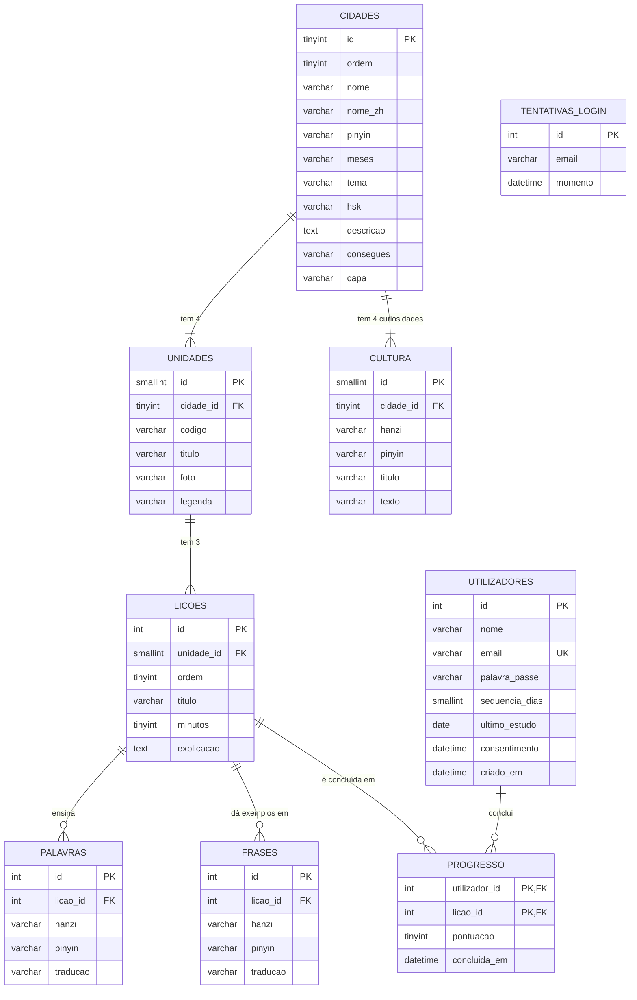

# Chá · Base de dados

> Versão 2 (13/10/2026). O script está em `base_de_dados/cha.sql`.
> Mudanças desde a versão 1: entraram a tabela `cultura` e as colunas novas de `cidades` e `unidades`; saíram as tabelas `revisoes` e `caderno` e as colunas `nivel` e `minutos_por_dia`, porque nenhuma página as usava.

## Como importo no phpMyAdmin (XAMPP)

1. Abro o **XAMPP Control Panel** e clico em **Start** no **Apache** e no **MySQL**.
2. Abro o browser em `http://localhost/phpmyadmin`.
3. Clico no separador **Importar** (no topo, sem escolher nenhuma base à esquerda).
4. Em **Ficheiro a importar**, escolho `base_de_dados/cha.sql`. O conjunto de caracteres deve ficar em **utf-8**.
5. Clico em **Importar** (ou **Executar**) no fim da página.
6. À esquerda aparece a base **cha** com 9 tabelas. No separador **Designer** vejo o diagrama com as ligações.

O script começa com `DROP DATABASE IF EXISTS cha`, por isso posso importar de novo sempre que mudar alguma coisa. **Atenção:** isso apaga os dados que já estavam na base, incluindo as contas criadas.

## Diagrama entidade-relação

## As tabelas em uma frase

| Tabela | O que eu guardo | Linhas no script |
|---|---|---|
| `utilizadores` | Quem tem conta: nome, e-mail, palavra-passe (só o hash), dias seguidos a concluir lições e a data do consentimento | 0 (criados no registo) |
| `cidades` | As 6 cidades da rota, com o pinyin, o nível HSK, a descrição e o que o aluno consegue fazer no fim | 6 |
| `unidades` | As unidades de cada cidade, com a foto e a legenda da foto | 24 |
| `cultura` | Curiosidades culturais de cada cidade, com a palavra em chinês e o pinyin | 24 |
| `licoes` | As lições de cada unidade, com uma explicação curta do tema | 72 |
| `palavras` | O vocabulário de cada lição, com hanzi, pinyin e tradução | 523 |
| `frases` | As frases de exemplo de cada lição, também com hanzi, pinyin e tradução | 222 |
| `progresso` | Que lições cada utilizador já concluiu, e quando | 0 |
| `tentativas_login` | As tentativas de login falhadas dos últimos 15 minutos (proteção contra força bruta) | 0 |

## O que fica na base e o que fica no browser

| Na base de dados (ligado à conta) | No browser (localStorage, só neste computador) |
|---|---|
| Conta, lições concluídas, dias seguidos a concluir lições | Palavras aprendidas nos cartões, revisão espaçada, caderno, dias de estudo, medalhas, resultados de pronúncia, modo escuro |

As ferramentas do Praticar funcionam sem conta, por isso guardam tudo no browser. Passar esses dados para a conta está descrito em `ideias-futuras.md` (ideia 4).

## Decisões que tomei (e porquê)

- **utf8mb4 + `SET NAMES utf8mb4`:** sem isso os caracteres chineses ficam embaralhados. Testei: sem a linha `SET NAMES`, 葡萄牙人 aparecia como `è‘¡è„牙人`.
- **Palavra-passe só como hash:** o PHP cria o hash com `password_hash()` (bcrypt, custo 12) e confirma-o com `password_verify()`. Nem eu consigo ver a palavra-passe de ninguém.
- **Chave primária dupla em `progresso`:** a combinação utilizador + lição só pode existir uma vez. É assim que represento a relação N:N entre utilizadores e lições.
- **`ON DELETE CASCADE`:** se um utilizador eliminar a conta, o progresso dele também é apagado. Isso cumpre o direito ao apagamento do RGPD (art. 17.º).
- **`consentimento`:** guardo quando o utilizador aceitou a política de privacidade, para provar o consentimento (RGPD, art. 7.º).
- **Não crio utilizadores de exemplo no SQL:** o hash da palavra-passe tem de ser feito pelo PHP, por isso os utilizadores nascem na página de registo.
- **Só guardo o que o site usa:** tirei as tabelas e colunas que estavam planeadas mas que nenhuma página lia.

## Testes que fiz (MariaDB 10.11, a mesma família do MySQL do XAMPP)

- O script importa sem erros e cria as 9 tabelas com 6 cidades, 24 unidades, 24 curiosidades, 72 lições, 523 palavras e 222 frases.
- O mesmo utilizador não consegue concluir a mesma lição duas vezes (a chave primária bloqueia, e o PHP usa `INSERT IGNORE`).
- Não dá para criar uma lição numa unidade que não existe (a chave estrangeira bloqueia).
- Ao eliminar um utilizador, o progresso dele desaparece junto.
- O PHP (PDO com `charset=utf8mb4`) lê os caracteres chineses corretamente.

## Ficheiros PHP que usam esta base

| Ficheiro | O que faz |
|---|---|
| `index.php` | Página inicial; com sessão iniciada, mostra o nome do aluno, as lições feitas e os dias seguidos |
| `rota.php` | A rota das 6 cidades, com o progresso de cada uma (consulta com `LEFT JOIN` e `GROUP BY`) |
| `cidade.php?id=` | Página de uma cidade: descrição, as 4 unidades com a foto e as lições, marcando as que o aluno já fez |
| `licao.php?id=` | Página de uma lição: explicação, palavras e frases com som, exercício e o botão «Concluir lição» |
| `concluir-licao.php` | Grava a lição no progresso e atualiza os dias seguidos |
| `cultura.php` | As curiosidades culturais de cada cidade |
| `folha.php` | A folha de treino de caracteres para imprimir |
| `registo.php` | Cria a conta (valida os dados, confirma a idade mínima e o consentimento) |
| `entrar.php` | Inicia sessão, com o limite de 5 tentativas falhadas em 15 minutos |
| `conta.php` | Mostra «A minha conta» |
| `eliminar-conta.php` | Elimina a conta e, em cascata, o progresso do utilizador |
| `includes/ligacao.php` | Liga o PHP à base `cha` com PDO e `charset=utf8mb4` |
| `includes/sessao.php` | Inicia a sessão e tem as funções `exigir_sessao()`, `iniciar_sessao()`, `token_csrf()`, `validar_csrf()` e `e()` |

Para testar no XAMPP, copio a pasta `mandarin_project` para `C:\xampp\htdocs\cha` e abro `http://localhost/cha/`. O Apache abre o `index.php` sozinho.
